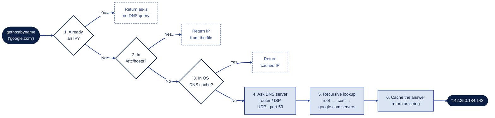

# levi

levi is a simple TCP port scanner that I wrote in Python while learning
networking. It takes an IP address or a hostname, tries to connect to the
ports I give it, and tells me which ones are open.

I built it with only Python's standard library (`socket`, `argparse`, `sys`,
`datetime`), because I wanted to see how a port scanner works from the inside
instead of just using one.

> [!WARNING]
> **Please read this before using levi.**
>
> I made this tool to learn, not to attack anyone. Only scan your own devices
> or systems you have written permission to scan. Scanning other people's
> systems without permission is illegal in many countries.
>
> This project is shared "as is", for educational purposes only. I accept no
> responsibility for any misuse or damage caused by this tool. Anyone who
> uses levi does so at their own risk and is fully responsible for making
> sure they have permission to scan their target.

---

## What It Does

- Scans a single port, a list of ports or a range (`80`, `22,80,443`,
  `1-1024`, `22,80-85`)
- Turns a hostname into an IP address before scanning
- Shows the usual service name for open ports (like `ssh` or `http`)
- Lets you change how long it waits for each port

## How to Run

You only need Python 3. Nothing else to install.

```bash
git clone https://github.com/yukselkaran/levi.git
cd levi
python3 levi.py <target> [-p PORTS] [-t TIMEOUT]
```

| Argument | What it means | Default |
|---|---|---|
| `target` | The IP address or hostname to scan | (required) |
| `-p`, `--ports` | Which ports to scan: `80`, `22,80,443`, `1-1024` | `1-1024` |
| `-t`, `--timeout` | How many seconds to wait for each port | `0.5` |

Some examples:

```bash
python3 levi.py 127.0.0.1
python3 levi.py 127.0.0.1 -p 22,80,443
python3 levi.py localhost -p 1-65535 -t 0.2
```

## Testing It on My Own Computer

The easiest way to see levi working is to open a port yourself and then find
it. I start a small web server in one terminal:

```bash
python3 -m http.server 8000
```

Then I scan around that port in another terminal:

```bash
python3 levi.py 127.0.0.1 -p 7990-8010
```

And levi finds it:

```
==================================================
  levi — port scanner
==================================================
  Target           : 127.0.0.1
  IP               : 127.0.0.1
  Port Number      : 21
  Initialization   : 2026-10-28 18:40:23
--------------------------------------------------
[+]  8000/tcp  open   unknown
--------------------------------------------------
[x] 1 Open port detected: 8000
[i] Duration: 0.00 sec
```

It says `unknown` for port 8000 because that port is not in the system's
service list. When I stop the server with `Ctrl+C` and scan again, port 8000
is gone.

If I give it something wrong, it tells me instead of crashing:

```
$ python3 levi.py 127.0.0.1 -p 80-20
[!] Invalid port expression: '80-20'
```

---

## How It Works

The code is split into small functions. Each one does one job, and `main()`
calls them in order:

```
main()
 ├── parse_args()        reads what I typed in the terminal
 ├── resolve_target()    turns the name into an IP
 ├── parse_ports()       turns the port text into a list of numbers
 ├── print_banner()      prints the header
 ├── for each port:
 │     scan_port()          is it open?
 │     get_service_name()   if yes, what is it usually called?
 └── print_summary()     prints how many ports were open and how long it took
```

### Turning a name into an IP

Computers connect with IP addresses, not names. So before scanning, levi uses
`socket.gethostbyname()` to turn something like `google.com` into an IP
address. I was surprised by how much happens behind this one line:



1. If I already gave it an IP, it just gives it back. No DNS needed.
2. It checks the `/etc/hosts` file on my computer.
3. It checks if the OS already looked up this name recently (DNS cache).
4. If not, it sends a small UDP packet on port 53 to the DNS server
   (usually my router or my internet provider).
5. If that server doesn't know, it asks the root servers, then the `.com`
   servers, then Google's own servers.
6. The answer comes back to Python as a string like `'142.250.184.142'`.
   (Big sites have many servers, so the IP can be different for you.)

If the name can't be found, Python raises `socket.gaierror`, and levi prints
a message and stops.

### Checking if a port is open

For every port, levi opens a TCP socket and calls `connect_ex()`. This starts
the TCP **3-way handshake**:

```
levi  ──SYN──────►  target
levi  ◄──SYN/ACK──  target    → OPEN: something is listening
levi  ◄──RST──────  target    → CLOSED: nothing is listening
levi  ... no reply ...        → FILTERED: a firewall dropped the packet
```

`connect_ex()` returns `0` if the connection works, so levi marks that port as
open. If it gets an error code instead (`111` on Linux, `61` on macOS) or the
time runs out, levi treats the port as closed.

I open the socket with `with`, so it closes by itself when the block ends.
Without this, scanning 1000 ports would leave 1000 sockets open.

This kind of scan is called a **TCP connect scan**. It is the same thing
`nmap -sT` does.

### Finding the service name

When a port is open, levi calls `socket.getservbyport()`. It takes a port
number and returns the name of the service usually assigned to that port, by
looking it up in a local list (`/etc/services`).

This is only a guess. It doesn't ask the port what is really running there.
If someone runs SSH on port 2222, levi won't know it is SSH.

---

## What It Can't Do (Yet)

- It only scans TCP, not UDP
- It only works with IPv4
- It scans one port at a time, so big ranges can be slow when a firewall
  drops packets
- It can't tell the difference between "closed" and "filtered"
- Service names are guesses based on the port number

## What I Want to Add Next

- [ ] Scan many ports at the same time with threads
- [ ] Save results to a file with `-o`
- [ ] Banner grabbing, to see what is really running on a port
- [ ] Show "closed" and "filtered" separately
- [ ] UDP scanning with `--udp`

## What I Learned

- **Sockets:** A socket is one end of a connection between two programs.
  With `AF_INET` and `SOCK_STREAM`, it means IPv4 and TCP.
- **TCP handshake:** An open port answers with SYN/ACK, a closed port answers
  with RST, and a filtered port doesn't answer at all.
- **`connect()` vs `connect_ex()`:** `connect()` raises an error when it
  fails, `connect_ex()` returns an error code instead. That makes it easier
  to use in a loop.
- **DNS:** Turning a name into an IP goes through `/etc/hosts`, the DNS cache
  and DNS servers, and DNS uses UDP on port 53.
- **Ports:** Port numbers go from 1 to 65535, because the port field in the
  TCP header is 16 bits.
- **`argparse`:** Everything from the command line comes in as text, so I
  need `type=float` to turn the timeout into a number.
- **`with` blocks:** They close the socket for me, even if something goes
  wrong.
- **Python vs C:** For this tool, most of the time is spent waiting for the
  network, not computing. So Python is fast enough, and it let me focus on
  how TCP works instead of memory management.

## License

MIT License. See [LICENSE](LICENSE).
